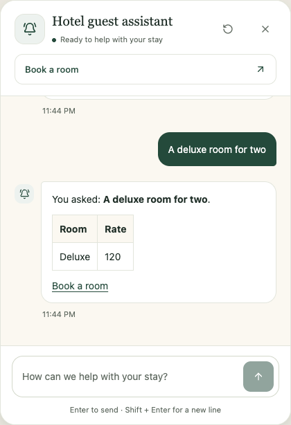
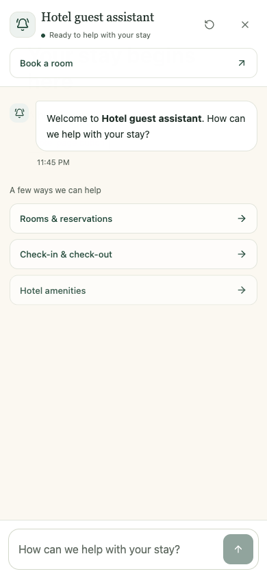
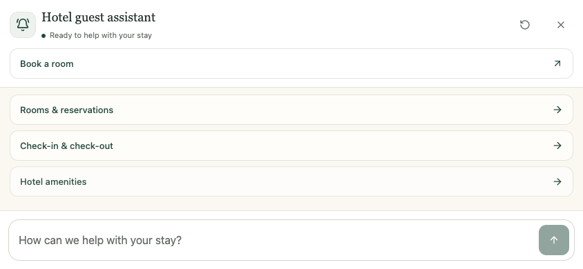

# Concierge widget refresh

The floating widget now uses forest green, ivory, serif headings, softer message
surfaces, and a rounded composer. It retains the existing assistant-ui runtime
and worker integration, with local shadcn Button, Avatar, and AlertDialog components.

Starter questions fill the composer without sending. A configured booking URL
opens in a new tab. User-initiated restart asks for confirmation when there is
history; cancellation keeps the conversation and draft. The same confirmation
handles session-expiry links.

Pending replies show animated dots and “Preparing your reply…”, directly
below the guest message. Empty optimistic assistant rows are omitted. Each
completed assistant reply shows device-local time below its bubble, with a full
accessible date/time and ISO datetime. The creation timestamp is shared across
tabs and preserved on reload. Legacy entries without time remain undated.

Optional reCAPTCHA v3 is described in the README. A rejected or unavailable
check restores the draft and shows retry feedback. The check runs before a
message enters history or the socket. Consecutive duplicate server messages
are filtered before fanout; `severe` events and the reference error codes are
supported in both live messages and restored history.

The phone panel fills the visible viewport edge to edge, without an outer frame.
Safe-area padding sits inside the header, message area, booking row, and composer.
This applies at widths up to 640px, plus touch-device landscape layouts up to
1024px wide and 500px high. The open panel hides the launcher. Opening focuses
the close control without opening the keyboard; choosing a prompt focuses the
composer. Closing, reopening, and resizing keep the draft. Scrolling to the
latest message moves focus to the panel so Escape remains usable. The development
page uses `viewport-fit=cover`; the widget leaves host metadata under host control.

## Calm GSAP motion

Motion uses GSAP and its React hook, scoped to each widget and cleaned up on
unmount. The existing assistant-ui store, shadcn components, and public props
and exports stay intact.

| Interaction | Motion |
| --- | --- |
| Desktop panel | 240ms entrance from 97% scale, 12px below, opacity 0; 160ms exit toward the launcher |
| Full-screen mobile panel | 180ms fade in, 120ms fade out; no scale or translation |
| New assistant reply | 180ms fade and 6px rise, once per message ID |
| Starter prompts | First pointer opening only: 160ms entrance with 40ms stagger |
| Typing dots | Opacity pulse only while pending, open, and in a visible browser tab |
| Pointer press | 97% scale over 100ms, restored over 120ms |

Entrances, exits, and presses use CustomEase `(0.23, 1, 0.32, 1)`.
Outgoing messages remain immediate. Reopening and restored history do not replay
reply animations; typing or clearing a draft does not replay prompt entrances.
Landing-page buttons preserve pointer versus keyboard activation.

The thread remains mounted during exits to retain drafts. Closing content is
inert and hidden from accessibility tools after focus moves outside it; launcher
focus returns after the exit. Reversing an animation preserves its current
position. Viewport sizing remains active until the panel finishes closing.
Keyboard actions finish entrances immediately; Escape closes instantly.
Reduced-motion changes cancel movement and stagger, allow fades up to 100ms,
and show static typing dots. Hidden panels/tabs stop the repeating typing loop.

The GSAP refresh passed its original 52 browser checks, typechecking, linting,
both WBE builds, and landing build. Desktop and mobile frames were inspected at normal and quarter
speed using the local fixture, without page errors. Standards and spec reviews
have no remaining findings. GSAP adds approximately 33 kB gzip to the landing
JavaScript and 39 kB gzip to the embeddable widget versus the preceding build.

## Previews

## November 4 validation

All 80 Chromium/WebKit checks, typechecking, linting, production/staging WBE
builds and the landing build passed. Desktop pending state and completed mobile
replies were visually inspected. Both review axes have no remaining findings.
Verification used SDK/verifier mocks and the local Socket.IO fixture.

## Regression coverage

The 26 existing widget checks across Chromium and WebKit use the real
widget/runtime/worker with a controlled local Socket.IO fixture. They cover
starter questions, booking, reset/expiry,
reconnecting, scroll-to-latest, empty restart, history restoration, errors,
Markdown, multiline input, timestamps, mobile bounds, focus, reduced motion,
and host-style isolation. Mobile checks require full coverage at 320px, 390px,
and 640px, plus touch-device landscape and shrinking viewports. The
visualViewport-unavailable regression simulates a viewport change without
a window resize event. The November 4 feedback checks cover dated replies,
legacy history, severe errors, duplicate filtering, shared tabs, verification
failures/retries, SDK readiness and cancellation of stale checks.

Run `npm run test:ui` for the complete suite, including 10 guest-page, 16 motion, and 28 feedback checks.
The WBE widget builds use `npm run build:production` and
`npm run build:staging`; `npm run build` runs both with typechecking.

Physical mobile Safari/Chrome software-keyboard behavior, the live backend, and
deployment on a real host site were not verified. Public props, module exports,
server authentication/chat payloads, storage keys, server logout/expiry, and
bubbling `qikres/chatbot/<trigger>` events retain their existing contracts.
